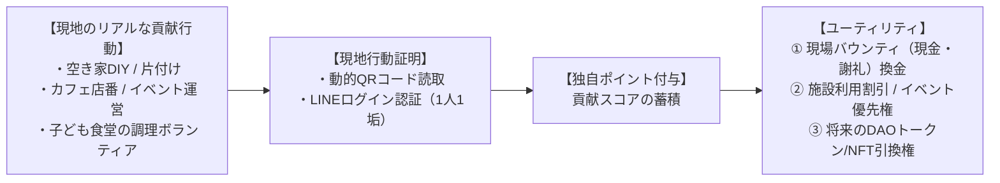

私たちは「善意のボランティアだから無償」という甘えを完全に排除します。獲得した外部資金（公金・外資）および実業売上から、現場のリアルな貢献に対して適正な対価（バウンティ・業務委託費・謝礼）を適法に支払います。透明性の高い報酬設計によって、持続可能なコモンズを実現します。

---

## 1. 職種別の報酬マトリクス

下表は、Open Coral Network が設定する主な職種・タスクと、その報酬体系の対応表です。貢献の性質に応じて「即時払い」「シフト制」「プロジェクト型」「レベニューシェア」を使い分けます。

| 職種 / タスク | 主な業務内容 | 報酬体系 |
| :--- | :--- | :--- |
| **現場DIY・空間再生** | 空き家の片付け、壁塗り、大工、日常清掃 | 時間給 / タスク完了型バウンティ（即時支給） |
| **拠点ホスピタリティ** | カフェ店番、子ども食堂調理、ゲスト案内、宿泊受付 | シフト制報酬 ＋ 売上インセンティブ |
| **Civic AI & システム開発** | 助成金AI改修、自治体ダッシュボード構築、ツール連携 | スプリント報酬 / プロジェクト型業務委託費 |
| **政策プロポーザル起草** | 自治体課題分析、助成金申請書作成、行政折衝 | 案件ディレクション費 ＋ 採択インセンティブ |
| **クリエイティブ・アート** | 映像制作、展示空間キュレーション、作品プロデュース | 制作委託費 ＋ 作品売上レベニューシェア |

---

## 2. 独自ポイント制度と現地行動証明（Local Proof of Action）

将来的なDAOトークンやNFTへの昇格を見据え、日々の現場貢献を記録・蓄積する「独自ポイント」を運用しています。ポイントは現金バウンティへの換金、施設利用割引、将来のDAO参加権など複数のユーティリティを持ちます。

### 不正（シビル攻撃）防止のローカライズ設計

地方住民に暗号資産ウォレットや1ドル決済を強いると参加障壁が高くなり、コモンズの理念に反します。Open Coral Network では以下の設計で不正を排除します。

<Accordion title="シビル攻撃防止の詳細設計">
  - 地域住民には **「LINE公式アカウント連携」＋「拠点現地に掲示された動的QRコード読取」** による現地行動証明を採用。
  - 1人1アカウント・1日1回限定の現地チェックインにより、自作自演や遠隔からの水増し不正を完全に遮断。
  - 動的QRコードは一定時間ごとに更新されるため、スクリーンショットによる転用も無効化。
  - LINE認証は日本の既存インフラを活用することで、高齢者や地方在住者でもハードルなく参加できます。
</Accordion>

<Note>
  現地チェックインは「その場にいたこと」の証明であり、作業量・貢献品質の評価とは別に記録されます。ポイント換算レートは職種・タスクの難易度や所要時間に応じてコア・チームが定期的に見直します。
</Note>

---

## 3. 適法な利益分配（第一項有価証券該当性の回避）

<Warning>
  **金融商品取引法への完全準拠**  
  NFTやトークン自体に「保有するだけで自動的に現金配当が出る」仕組みは、金融商品取引法上の有価証券に該当し違法となるリスクがあります。  
  当組織における金銭還元は、すべて **「空き家DIY、清掃、開発、運営等に現実に従事したメンバーへの適法な業務委託費・活動謝礼（バウンティ）」** として支払われます。
</Warning>

報酬の支払いは以下の原則に従います。

<Steps>
  <Step title="貢献の実在性を証明してから支払う">
    Local Proof of Action のチェックイン記録、成果物の提出、または現地立会い確認を支払いの前提条件とします。
  </Step>

  <Step title="業務委託契約書または活動謝礼合意書を締結する">
    金額・業務内容・支払い期日を明文化し、双方が合意した書面または電子契約を交わします。
  </Step>

  <Step title="源泉徴収・インボイス対応を適切に処理する">
    支払い金額・支払い先に応じて源泉所得税の徴収・納付を行い、適格請求書（インボイス）制度にも準拠します。
  </Step>
</Steps>
