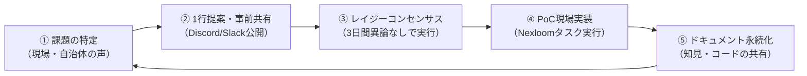

Open Coral Network では、上司の指示を待つのではなく、メンバー一人ひとりが課題を発見し、自律的にスプリントを回してプロジェクトを推進します。意思決定はレイジーコンセンサス方式で行い、小さな一歩を素早く積み重ねることで、現場の変化に即応した共創を実現します。

---

## 1. アジャイル・スプリントのサイクル

スプリントは①課題の特定から始まり、提案・合意・実装・ドキュメント化を経て次のサイクルへとつながります。各ステップで立ち止まらず、素早く小さく回し続けることが重要です。

<Steps>
  <Step title="① 課題の特定">
    現場や自治体パートナーからの声、日々の活動で気づいた問題点を起点に課題を定義します。「誰が困っていて、何が解決されると良いか」を1〜2文で言語化してください。
  </Step>
  <Step title="② 1行提案・事前共有">
    解決策のアイデアを1行で要約し、該当プロジェクトの**公開チャンネル**（Discord または Slack）に投稿します。チームの誰もが内容を把握できる状態を作ることが目的です。
  </Step>
  <Step title="③ レイジーコンセンサス">
    投稿後 **3日間** 異論・懸念が寄せられなければ、合意成立とみなして次のステップへ進みます。反対意見がある場合は、チャンネル上で建設的に議論し、修正版を再提案してください。
  </Step>
  <Step title="④ PoC現場実装">
    Nexloom タスクボードにタスクを作成し、担当者・期日・完了条件を明記したうえで実装に着手します。小さく動くものを素早く届けることを優先してください。
  </Step>
  <Step title="⑤ ドキュメント永続化">
    実装後は学んだ知見・コード・決定事項を所定の場所（下記 Writeback 原則参照）に記録します。チャットのタイムラインに流れたままにしないことが組織知の蓄積につながります。
  </Step>
</Steps>

---

## 2. 成果物の残し方（Writeback 原則）

活動の知見や成果物は、個人のローカルやチャットの流れるログに放置せず、必ず以下の場所に永続化してください。チームメンバーが時間・場所を問わず参照できる状態が、自律分散型組織の生命線です。

| 成果物の種類 | 格納場所 |
| :--- | :--- |
| **公式決定事項・仕様書** | [Nexloom Wiki ページ](https://ai-note-meet.vercel.app) または 本ハンドブック |
| **タスク進捗・ToDo** | [Nexloom タスクボード](https://ai-note-meet.vercel.app) |
| **定例ミーティング議事録** | Nexloom AIミーティング記録（自動生成・タスク連動） |
| **ソースコード・システム** | [GitHub リポジトリ](https://github.com/t012093/plural-commons-japan) |
| **各種申請・台帳** | Notion 共有ワークスペース |

<Tip>
  議事録は Nexloom の AI ミーティング機能が自動生成し、アクションアイテムはタスクボードへ自動連携されます。会議後に手動でメモを転記する必要はありません。
</Tip>

<Note>
  「あとで書く」は「永遠に書かない」と同義です。実装直後のコンテキストが残っているうちにドキュメントを更新する習慣を身につけてください。
</Note>
