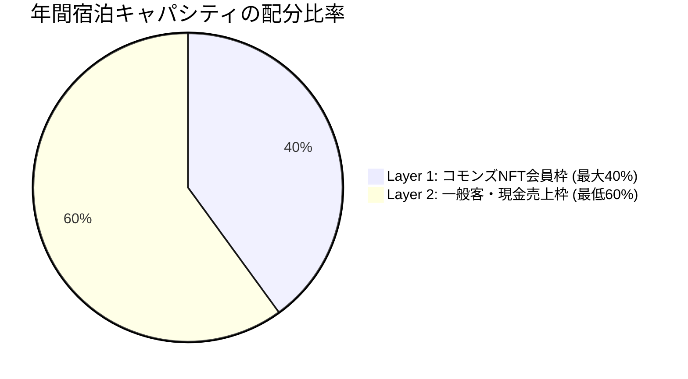

当法人では、全国で放置される空き家・古民家を**「オンラインとオフラインが融合するコミュニティ共有地（サードプレイス）」**としてリノベーションし、日常的な交流・制作・ワーケーション拠点として再生・運営しています。各拠点はカフェ・コワーキング・宿泊の複合機能を持ち、地域住民とゲストが共に使える場を目指しています。

---

## 1. 拠点の多目的機能

各サードプレイス拠点は、時間帯や曜日によって多様な表情を持ちます。

<Accordion title="1階 コミュニティラウンジ ＆ カフェ">
  * 昼間は近隣住民や子どもたちが集う「子ども食堂」「多世代サロン」。
  * 週末は地域のお茶会や、手仕事・アートのワークショップを開催。
</Accordion>

<Accordion title="コワーキング ＆ アトリエスペース">
  高速Wi-Fi・電源完備。デジタルノマド、エンジニア、アーティストが滞在制作できるオープンスタジオ。
</Accordion>

<Accordion title="簡易宿所（宿泊・ワーケーション）">
  旅館業法に基づく「簡易宿所営業（年間365日稼働）」の許可を取得。国内外からの旅人やワーケーション客を受け入れ、日々の定常実業キャッシュフローを生み出します。
</Accordion>

---

## 2. 宿泊予約と「40/60 キャパシティ管理ルール」

先行する山古志村DAOの反省点（会員の無料宿泊枠で日数が枯渇し、リネン費・光熱費で赤字になる構造）を克服するため、厳格なキャパシティ管理を行っています。年間宿泊キャパシティは以下の比率で配分されます。

<Warning>
  **原価防衛と実業キャッシュフローの死守**

  * **Layer 1（会員優待枠）**: 年間総提供日数の**最大40%**に制限。繁忙期（GW・お盆・年末年始）は除外日（ブラックアウト）を設定。
  * **Layer 2（一般客枠）**: **最低60%は必ずAirbnb等の一般客の現金売上枠として確保**し、日々の光熱費・維持費・現場スタッフへの人件費を賄う黒字構造を維持します。
</Warning>

---

## 3. 現地利用の心得とマナー

拠点はメンバー全員で守るコモンズです。気持ちよく使い続けるために、以下の3点を必ず守ってください。

<Steps>
  <Step title="みんなで守るコモンズ" icon="broom">
    使った場所の片付け・ゴミの分別・簡単な掃除は、利用者全員が主体的に行います。
  </Step>

  <Step title="地域住民への配慮" icon="house-chimney-user">
    夜間（21時以降）の騒音防止、指定場所以外での駐車禁止など、地域コミュニティとの調和を最優先します。
  </Step>

  <Step title="安全管理" icon="shield-halved">
    火の元の確認、退室時の施錠を徹底してください。破損や異常を発見した際は直ちに現場担当者へ報告してください。
  </Step>
</Steps>

<Note>
  拠点の利用に関する質問や追加ルールは、各拠点の現場担当者または Discord の `#bases-support` チャンネルでご確認ください。
</Note>
