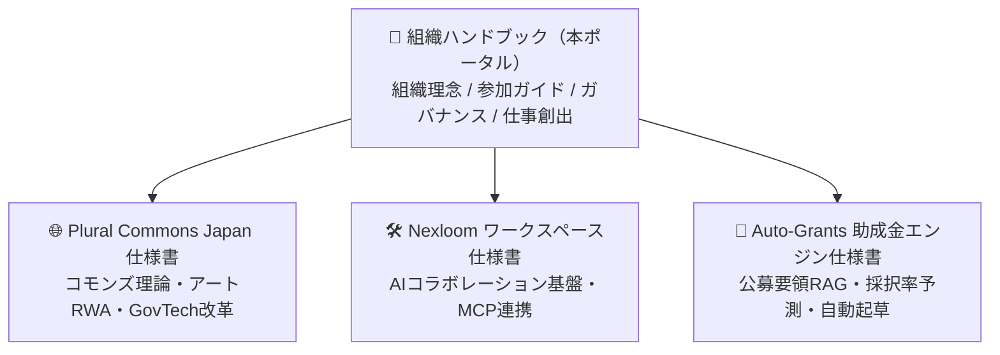

当法人が開発・運営している中核プロジェクトの技術仕様書、政策提言書、システム設計ドキュメントへのリンク集です。ハンドブック（本サイト）では組織全体のルール・参加方法・ガバナンスを扱っており、各プロジェクトの具体的な実装詳細や仕様については、以下のそれぞれの専用ドキュメントをご参照ください。

<Note>
  **ハンドブックとプロジェクト仕様書の役割分担**  
  このハンドブック（本ポータル）は組織全体のルールや文化・参加手順を定める「組織のOS」です。各プロジェクトのシステム設計・技術仕様・政策立案の詳細は、それぞれの専用仕様書（Deep Specs）に集約されています。まずハンドブックで全体像を把握し、実装の深掘りは専用仕様書へとお進みください。
</Note>

---

## 🚀 進行中の公式プロジェクト

<CardGroup cols={2}>
  <Card
    title="🌐 Plural Commons Japan"
    icon="network-wired"
    href="/projects/plural-commons"
  >
    4大コモンズ構想（空間・居場所・文化・資金）、アートRWA真贋認証・トークノミクス、Zaisei Radar、自治体IT調達改革の完全仕様書。
  </Card>

  <Card
    title="🛠️ Nexloom 統合ワークスペース"
    icon="cube"
    href="/projects/nexloom-workspace"
  >
    チャット、ドキュメント、タスク、LiveKit AI議事録、60種超のリモートMCP（Model Context Protocol）を一体化したワークスペース基盤。
  </Card>
</CardGroup>

---

## 💡 プロジェクト仕様書の役割

組織ハンドブックを起点として、各プロジェクトの専用仕様書へとドリルダウンする構造になっています。

